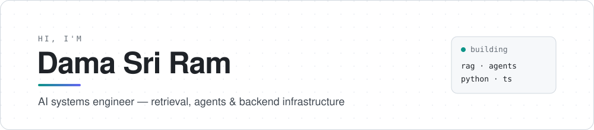

<picture>
  <source media="(prefers-color-scheme: dark)" srcset="assets/header-dark.svg">
  
</picture>

  <samp>
    <a href="https://sriram2272.github.io">portfolio</a> ·
    <a href="https://linkedin.com/in/dama-sriram">linkedin</a> ·
    <a href="mailto:sriramdama417@gmail.com">email</a>
  </samp>

I build retrieval pipelines, autonomous agents, and the backend services that keep them fast in production. Lately I've been working on RAG evaluation and agentic browser automation. CSE undergrad, Microsoft Learn Student Ambassador.

## Selected work

**[GhostCut](https://github.com/Sriram2272/GhostCut-Hallucination-Hunter)** · forensic claim verification
 🥈 2nd place, IIT Roorkee E-Summit 2026 (550+ teams)
 RAG + NLI engine that checks claims against 10K+ document chunks and returns evidence-backed verdicts with a trust score. 91% NLI accuracy, under 200 ms latency.
 `Python` `LangChain` `SBERT` `RoBERTa` `React` `PostgreSQL`

**Web Navigator** · autonomous browser agent
 🚀 Selected for T-Hub Hyderabad incubation (top 1% of 1,000+ teams)
 Runs multi-step workflows across 100+ pages per session. Concurrent Playwright pipelines cut a 55-minute job to 7 minutes at 95% extraction accuracy.
 `Python` `Playwright` `LangChain` `AsyncIO`

**[Retrieval Integrity Auditor](https://github.com/Sriram2272/Retrieval-Integrity-Auditor-for-RAG-Systems)** · RAG evaluation framework
 Coverage scoring and top-k analysis over 1,000+ queries. Surfaces missing evidence and cuts irrelevant retrieval noise by 28%, with explainable diagnostics.
 `Python` `FAISS` `OpenAI` `Streamlit`

**[FinPilot](https://github.com/Sriram2272/finpilot)** · say or type an expense, get a ledger entry · [live](https://finpilot.bytexl.live)
 Turns a spoken or typed note into a validated transaction using structured LLM output, with an offline rule-based fallback.
 `React` `Express` `MongoDB` `Claude API`

**[Fruit Ripeness Grading](https://github.com/Sriram2272/fruit-ripeness-ordinal-regression)** · ordinal regression
 Compares a CORAL ordinal head with a cross-entropy baseline on the same ResNet-18, with a web demo that grades photos live.
 `PyTorch` `ResNet-18` `HTML`

## Stack

  

Also: LangChain · SBERT · FAISS · Pinecone · Supabase · Playwright

## Elsewhere

- 15+ merged pull requests in open-source codebases
- 1,450+ problems solved on LeetCode and CodeChef
- Microsoft Learn Student Ambassador, 200+ students mentored
- Certified: Microsoft AZ-900 · AI-900 · DP-900, Oracle OCI, Google Cloud

 

Open to backend and AI engineering roles. The quickest way to reach me is <a href="mailto:sriramdama417@gmail.com">email</a>.

